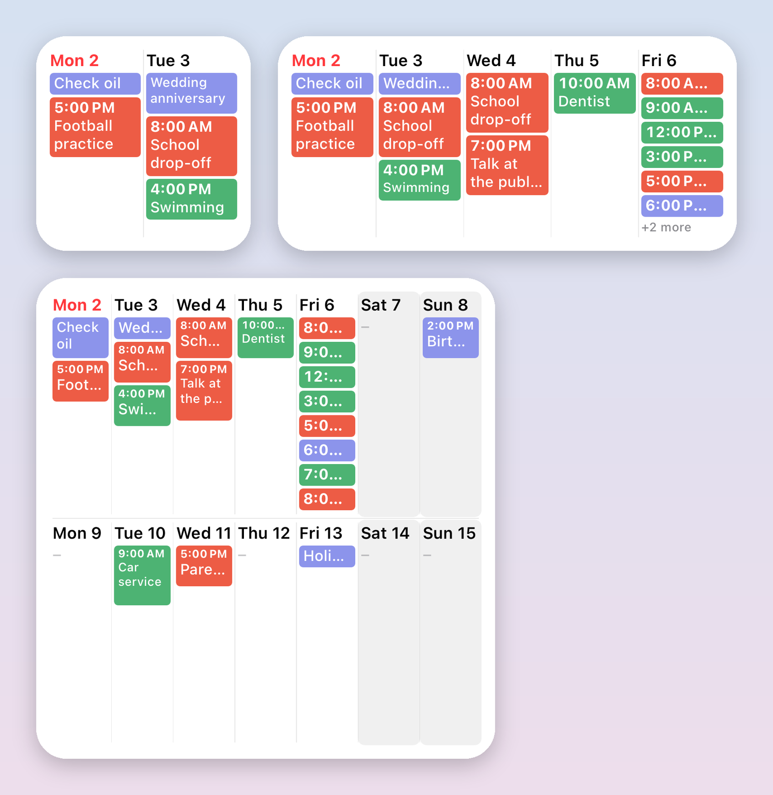
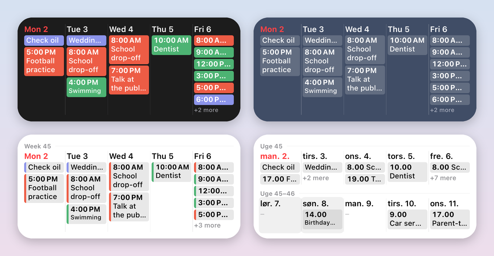

# WeekPeek

A week-at-a-glance calendar widget for iPhone. WeekPeek shows your upcoming events in a compact grid on the Home Screen and opens your calendar app on the day you tap.

<p align="center">
  
</p>

## Features

- Small, medium and large Home Screen widgets, also shown in StandBy
- Choose the number of days (1–14) and columns (1–7); extra days wrap into more rows
- Start on today or on a fixed weekday
- Lines per event (Auto, 1, 2 or 3): Auto shrinks the longest titles first and shows "+N more" when a day is full
- Text size from 8 to 20 pt
- Optional start times and week numbers ("Week 45" above each week)
- Calendar colors, a color stripe or a single color
- Days off (weekend or chosen weekdays) shown with a soft background
- All-day events shown, grouped at the top or hidden; declined and finished events can be hidden
- Opens Google Calendar, Apple Calendar, Microsoft Outlook or Fantastical
- 38 languages, following the iPhone's language (including right-to-left)

Every setting is per widget, under **Edit Widget**.

<p align="center">
  
</p>

## Privacy

WeekPeek collects no data. It has no network code, analytics or tracking. Events are read on the device through EventKit and never leave it. See the full [privacy policy](PRIVACY.md).

## Building

Requirements: Xcode 26 or later, iOS 26 SDK, and [XcodeGen](https://github.com/yonaskolb/XcodeGen).

```sh
xcodegen generate
open KalenderWidget.xcodeproj
```

The Xcode project and the `Info.plist` files are generated from `project.yml` and are not checked in. To run on a device, set your own development team and bundle identifiers in `project.yml`.

Run the tests:

```sh
xcodebuild test -project KalenderWidget.xcodeproj -scheme KalenderWidget \
  -destination 'platform=iOS Simulator,name=iPhone 17'
```

The render tests also write PNG previews of the widget in every size and language to `~/drive/src/renders` when run in the Simulator.

## Project layout

| Folder | Contents |
| --- | --- |
| `App/` | The app: calendar access, language shortcut and a short guide |
| `Widget/` | The widget extension and its timeline provider |
| `Shared/` | Layout engine, widget view, settings, event loading and translations |
| `Tests/` | Unit tests for the layout logic, deep links and render previews |
| `tools/` | Script that draws the app icon |

The project and targets are still named `KalenderWidget` from the first prototype.

## Known limitations

- Google Calendar and Outlook have no documented link to a specific date, so they open on today (Outlook on its calendar tab). Apple Calendar and Fantastical open the tapped day.
- Text fitting in the widget uses measured estimates; very narrow layouts (7 columns in the large widget) truncate titles quickly.
- Translations have not yet been reviewed by native speakers. Corrections are very welcome.

## About this project

WeekPeek is a hobby project, openly "vibe coded" with the help of AI (Claude by Anthropic) and maintained in spare time. It is free, has no ads or in-app purchases, and is not made to earn money. You are free to do whatever the MIT license allows: build it yourself, change it or share it.

Issues and pull requests are welcome, but responses may be slow.

## License

[MIT](LICENSE)
